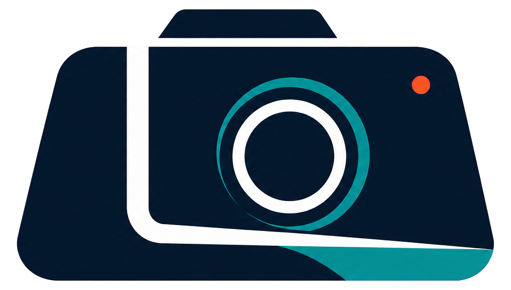
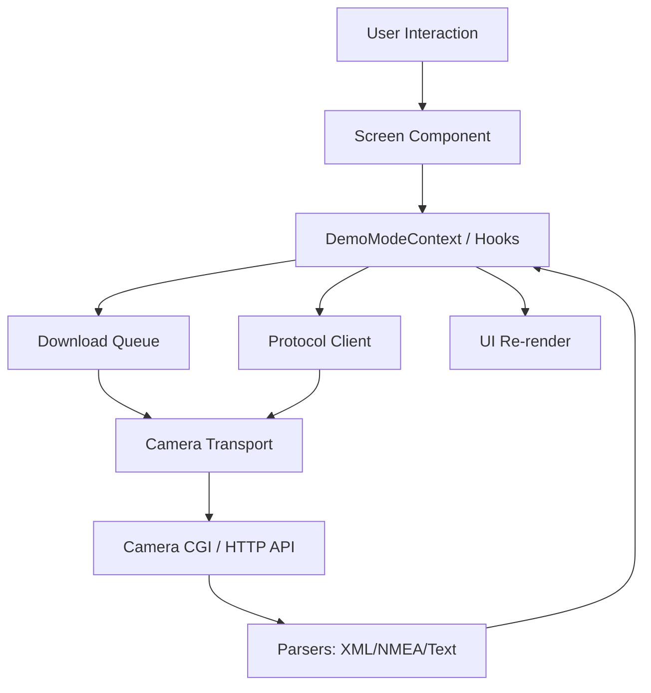
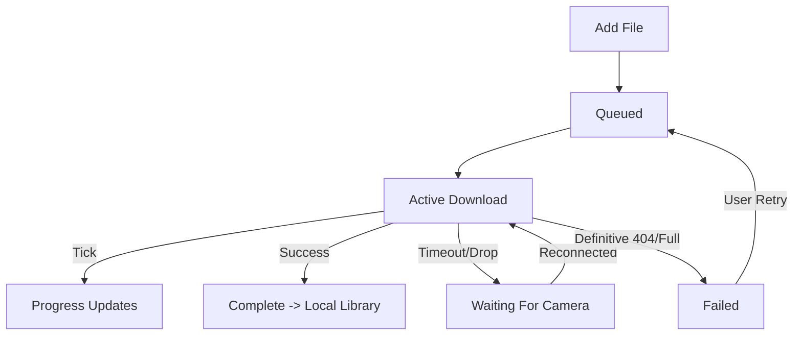

<div align="center">



# Laneory · Dashcam Companion

<em>Mobile app · Local dashboard · TypeScript CLI.</em>

<br />

<a href="https://github.com/pateutz1/MiVue-Pro">github.com/pateutz1/MiVue-Pro</a>

<br />


<br />


<strong>Local-first &middot; Wi-Fi connection &middot; Recording library &middot; Download queue &middot; GPS routes</strong><br>
<sub>Model and firmware support is tracked in the <a href="docs/compatibility.md">compatibility registry</a>. CLI checks: <code>npm run check</code>. Mobile checks: <code>npm run typecheck</code>, <code>npm test</code>, and <code>npm run licenses:check</code> from <code>mobile/</code>.</sub>

<br />

[Stack](#stack) &middot; [The app](#the-app) &middot; [Local setup](#local-setup) &middot; [Local dashboard](#local-dashboard) &middot; [Deployment](#deployment)

<sub><b>AI agents / LLMs:</b> repository conventions and protocol validation rules live in <a href="AGENTS.md"><code>AGENTS.md</code></a>.</sub>

</div>

---

## Overview

Laneory is an independent dashcam companion for iOS and Android, with a local web dashboard and a TypeScript CLI. It connects to a legally owned camera over Wi-Fi to browse recordings, download videos and photos, play saved footage, and explore GPS routes extracted from NMEA telemetry. The mobile app includes a demo mode with synthetic data, a persistent download queue, local media management, and camera settings gated by model and firmware capabilities. Files and preferences stay local by default; online maps are optional.

The tested camera is the Mio MiVue 866 with firmware `VI100.24.50.BE1WD.10`. Compatibility with other models or firmware is not implied. Laneory is independent and is not affiliated with or endorsed by Mio/MiTAC.

## Table of Contents

- [Laneory · Dashcam Companion](#laneory--dashcam-companion)
  - [Overview](#overview)
  - [Table of Contents](#table-of-contents)
  - [Stack](#stack)
  - [The app](#the-app)
  - [Architecture overview](#architecture-overview)
  - [Prerequisites](#prerequisites)
  - [Local setup](#local-setup)
    - [1. Clone and install](#1-clone-and-install)
    - [2. Camera connection](#2-camera-connection)
    - [3. Mobile setup](#3-mobile-setup)
    - [4. Validation](#4-validation)
    - [5. Run the CLI or dashboard](#5-run-the-cli-or-dashboard)
  - [Commands](#commands)
  - [Local dashboard](#local-dashboard)
  - [Deployment](#deployment)
  - [Contributing](#contributing)
  - [Contributors](#contributors)
  - [License](#license)
  - [Support the project](#support-the-project)
  - [Connect](#connect)

---

## Stack

| Layer | Technology |
| --- | --- |
| Mobile framework | React Native 0.86 + Expo 57, prebuild / development builds |
| UI library | React 19 |
| Language | TypeScript |
| Navigation | Expo Router |
| Lists | Shopify FlashList |
| Animation | React Native Reanimated |
| Typography | Source Sans 3, IBM Plex Mono |
| Media | Expo Video, FileSystem, Sharing, Video Thumbnails |
| Local preferences | AsyncStorage |
| Maps | Leaflet / OpenStreetMap, optional online tiles |
| Camera transport | Shared contracts and local native modules, including HTTP/1.0 TCP |
| CLI / dashboard | Node.js 20+, tsx, browser JavaScript |
| Tests | Node.js test runner + tsx |
| Distribution | EAS Build / EAS Update |
| Package manager | npm |

---

## The app

1. **Connection** — onboarding, discovery, manual host configuration, and visible connection state.
2. **Library** — Normal, Event, Parking, and Photo recordings with thumbnails, filters, sorting, and multi-selection.
3. **Downloads** — persistent queue, progress, and one active camera transfer at a time. Selecting a recording does not start a download.
4. **Local media** — offline playback, sharing, and local storage management.
5. **GPS routes** — NMEA telemetry, statistics, synchronized playback, offline schematic routes, and optional online maps.
6. **Camera settings** — supported settings and maintenance actions through centralized validation and verification.
7. **Demo mode** — synthetic recordings and simulated downloads without a physical camera.

Remote video playback remains an internal preview feature pending physical playback and seek validation on iOS and Android. Live-view RTSP is unavailable on the tested firmware. See [compatibility](docs/compatibility.md) for feature-specific status.

---

## Architecture overview

- **Mobile app** — Expo Router screens in `mobile/app/`, feature components, hooks, and packages. See [mobile architecture](docs/mobile/architecture.md).
- **Protocol** — parsers, request structures, and capability validation stay separate from UI. [Protocol documentation](docs/protocol.md) distinguishes `apk-observed`, `camera-confirmed`, and `production-validated` behavior.
- **CLI and dashboard** — TypeScript services in `src/` and browser assets in `web/`, separate from mobile.
- **Mutations** — `src/cameraMutate.ts` and the mobile equivalent centralize identity, firmware, capability, target, audit, and post-execution checks. Destructive requests do not inherit generic read retries.
- **Downloads** — CLI transfers stream to `.part` files and rename after size validation. Existing files are not overwritten. Mobile uses its own persistent queue.
- **GPS** — checksum-validated NMEA parsing and GPX export. The schematic route stays local; online tiles are opt-in.
- **Analysis boundary** — APK/XAPK, decompiled materials, raw traffic, and analysis databases stay outside Git and releases. Product functionality is independently implemented.

---

## Prerequisites

- **Node.js 20 or newer** and npm for the CLI.
- A legally owned, supported camera and a computer or phone connected to its Wi-Fi for physical tests.
- Optional Ethernet for simultaneous internet access on the computer.
- For mobile development, the project's Expo toolchain and a development build containing its native modules. Expo Go is limited to demo and fetch-probe workflows.

The tested setup assigned `192.72.1.100` to the laptop and used `192.72.1.1` as the gateway. An IP address alone does not identify a camera.

---

## Local setup

### 1. Clone and install

```powershell
git clone https://github.com/pateutz1/MiVue-Pro.git
cd MiVue-Pro
npm install
```

### 2. Camera connection

Connect to the camera's Wi-Fi, then inspect it:

```powershell
npm run dev -- discover
npm run dev -- info --host 192.72.1.1
```

Use the detected host if it differs. Mutation workflows also verify identity, model, firmware, session, and capabilities.

### 3. Mobile setup

Install mobile dependencies separately:

```powershell
cd mobile
npm install
```

See [mobile setup](mobile/README.md) and the [framework decision](docs/mobile/adr-001-framework.md). Native camera transport requires a build containing the corresponding modules.

### 4. Validation

From the repository root:

```powershell
npm run check
```

From `mobile/`:

```powershell
npm run typecheck
npm test
npm run licenses:check
```

### 5. Run the CLI or dashboard

From the repository root:

```powershell
npm run dev -- list --host 192.72.1.1 --count 5
npm run dev -- list --host 192.72.1.1 --category parking --json
npm run dev -- list --host 192.72.1.1 --all --summary
npm run dev -- download /SD/Parking/F/PARK260716-033609F.MP4 --host 192.72.1.1 --output ./downloads
npm run dev -- gpx ./downloads/PARK260716-033609F.NMEA
npm run dev -- web --host 192.72.1.1
```

The download path is an example; select an existing file from your camera's listing. The dashboard opens at [http://127.0.0.1:4173](http://127.0.0.1:4173).

---

## Commands

| Command | Description |
| --- | --- |
| `npm run dev -- discover` | Discover cameras on local IPv4 interfaces |
| `npm run dev -- discover --debug` | Show connection diagnostics |
| `npm run dev -- info --host <host>` | Read status and confirmed information |
| `npm run dev -- list --host <host> --all --summary` | List all pages and summarize |
| `npm run dev -- download <camera-path> --host <host> --output ./downloads` | Download with progress and size validation |
| `npm run dev -- gpx <local-file.NMEA>` | Convert local NMEA to GPX |
| `npm run dev -- web --host <host>` | Start the local dashboard |
| `npm run build` | Compile root TypeScript |
| `npm test` | Run root tests |
| `npm run check` | Build and run root tests |
| `npm run typecheck` (in `mobile/`) | Check mobile TypeScript |
| `npm test` (in `mobile/`) | Run mobile tests |
| `npm run licenses:check` (in `mobile/`) | Check third-party license data |

Consult [protocol](docs/protocol.md) and [AGENTS.md](AGENTS.md) before executing mutation or maintenance operations.

---

## Local dashboard

The dashboard listens exclusively on the loopback interface at `http://127.0.0.1:4173`.

- Browse thumbnails, filter by category, camera, duration, and date, or sort by date, time, duration, size, and name.
- Start downloads explicitly from a recording or multi-selection. Follow real progress and completion notifications.
- Manage local favorites, view download storage usage, and open the folder in Explorer.
- Play recordings with AAC audio and synchronized GPS routes. The schematic route stays local; OpenStreetMap is optional.
- Listings are cached for about 25 seconds; Reload forces refresh. Thumbnails use a two-request pool and disk/memory caching. Large lists use virtualization.

Keep `downloads/` outside OneDrive synchronization when possible. Camera firmware can disable Wi-Fi; software cannot reactivate the physical access point. Full listing has a 10,000-file safety limit. CLI downloads do not automatically resume; Range and preview validation are tracked in [compatibility](docs/compatibility.md).

Details: [dashboard](docs/dashboard.md), [troubleshooting](docs/troubleshooting.md), [research](docs/research-notes.md), and [security](docs/security-and-legal.md).

---

## Deployment

The CLI and dashboard run locally. Mobile distribution uses `mobile/eas.json`:

| Profile / channel | Purpose |
| --- | --- |
| `development` | Internal development client with native modules |
| `preview` | Internal distribution and validated OTA updates |
| `production` | Release target requiring explicit authorization |

Validated OTA-compatible JavaScript, TypeScript, and asset changes use the `preview` branch. Native code, Expo plugins, permissions, entitlements, or native dependency changes require a compatible new build.

The manual [Build iOS for SideStore](https://github.com/pateutz1/MiVue-Pro/actions/workflows/build-sidestore-ios.yml) workflow is also present. Store submission requires explicit approval, trademark clearance, and the [release legal checklist](docs/legal/release-legal-checklist.md). See [store listing drafts](docs/mobile/store-listing.md) and [trademark usage](docs/legal/trademark-usage.md).

---

## Contributing

Bugs and ideas go to [Issues][issues]. Read [AGENTS.md](AGENTS.md), [protocol](docs/protocol.md), and [compatibility](docs/compatibility.md) before changing camera behavior. Include relevant unit and mocked integration tests, and document physical validation separately.

Keep analysis materials, credentials, raw traffic, downloads, and build outputs out of commits and releases. New capabilities must document validation, timeouts, retries, audit, and verification before being described as production-ready.

## Contributors

Thanks to everyone who has contributed to Laneory.

<a href="https://github.com/pateutz1/MiVue-Pro/graphs/contributors">
  
</a>

## License

No root `LICENSE` file is currently provided. Do not assume an MIT or other open-source license. Third-party notices and release requirements are tracked in the legal documentation and mobile license tooling.

## Support the project

Report reproducible bugs, share model and firmware test results from your own camera, or suggest improvements through [Issues][issues]. Star the [repository][repo] to follow development.

## Connect

<div align="center">

**Adrian Cristache** · [aristache.dev](https://www.aristache.dev)

<a href="https://github.com/pateutz1/MiVue-Pro"></a>
<a href="https://www.aristache.dev"></a>

</div>

[repo]: https://github.com/pateutz1/MiVue-Pro
[issues]: https://github.com/pateutz1/MiVue-Pro/issues

# Laneory

**Professional dashcam companion app for MiVue cameras**

Laneory is an independent mobile application for iOS and Android that connects to your MiVue dashcam over Wi-Fi, giving you complete control over your camera, recordings, and GPS data—all from your phone.

> **Note:** Laneory is an independent application, not affiliated with or endorsed by Mio/MiTAC. It is designed for legally owned MiVue cameras and follows documented interoperability protocols.

---

## Quick Start

### Prerequisites

- iOS 13.0+ or Android 8.0+
- MiVue dashcam with Wi-Fi capability
- Both devices connected to the same Wi-Fi network (or connected to camera's AP)

### Installation

For development using Expo Go:

```bash
cd mobile
npm install
npm start
```
*(Scan the QR code from the terminal using the Expo Go app).*

For a development build with native HTTP streaming (`http10-tcp` module):

```bash
cd mobile
npm install
npm run build:dev:ios  # or android
npm run start:dev-client
```

### First Connection

1. Open Laneory and complete the onboarding.
2. Ensure you are connected to the camera's Wi-Fi network.
3. The app will connect automatically or you can input the IP manually via **Settings → Camera**.
4. Browse your recordings in the **Library** tab.

---

## Features

### Camera Control & Connection

- **Auto-Discovery**: Finds MiVue cameras on your network.
- **Manual IP Configuration**: Direct IP input if the camera uses a custom configuration.
- **Demo Mode**: Explore the full UI using synthetic files and simulated download queues without a physical camera.
- **Connection Status**: Real-time connection indicators (Live, Demo, Reconnecting, Failed).
- **Camera Info**: Read firmware, safety camera data, and voice package version.

### Video Library Management

- **High-Performance Lists**: Powered by `FlashList` for smooth scrolling even with thousands of clips.
- **Smart Filtering**: Filter by `Normal`, `Event`, `Parking`, or `Photo`.
- **Flexible Sorting**: Sort chronologically (Newest/Oldest) or by Name/Size.
- **Multi-Select**: Long-press any clip to enter selection mode for batch downloads or deletion.
- **Download Queue**: 
  - Background downloads with progress tracking and persistent state.
  - Automatic retry on network interruption and recoverable errors.
  - Resume support for partial downloads.
- **Video Playback**: 
  - Player using `expo-video` with scrubbing, playback speed, and Picture-in-Picture.
- **Refresh on Demand**: Pull-to-refresh to sync with the camera library without losing your download queue.

### Local Storage

- **Downloaded Files Manager**: Browse clips saved natively to your device.
- **Offline Playback**: Watch downloaded videos without connecting to the camera.
- **Storage Management**: Grouped storage breakdown (Camera vs Local) and bulk local cleanup.

### GPS & Route Tracking

- **Interactive Map**: Online map powered by `Leaflet` / `OpenStreetMap` tiles (opt-in).
- **Schematic Route**: Fully offline schematic view available when no internet is present.
- **Synchronized Playback**: The location marker scrubs alongside the video playback.
- **Route Statistics**: Distance, average speed, max speed, and duration extracted from NMEA telemetry.

### Camera Settings

Hardware settings you can configure directly from the app (if supported by your camera model):

- **Frequency**: 50Hz / 60Hz.
- **Exposure Compensation (EV)**: Adjust brightness (-1.0 to +1.0).
- **Date & Time Mode**: GPS Sync or Manual.
- **Time Zone**: GMT offsets.
- **Daylight Saving Time**: +1 hour, -1 hour, etc.
- **Format SD Card**: Safely wipe camera storage through a centralized mutation flow with secondary confirmation.

---

## Design System

Laneory uses a semantic design token system stored in `constants/Theme.ts` to seamlessly adapt to Light, Dark, and OLED modes.

### Color Palette

The app uses a distinct Teal/Navy theme to remain completely separate from the manufacturer's brand.

| Token | Light | Dark |
|-------|-------|------|
| **Background** | `#eef2f5` | `#0b1220` |
| **Surface** | `#f8fafc` | `#121a28` |
| **Brand (Teal)** | `#0f766e` | `#14b8a6` |
| **Text** | `#0f1720` | `#e8eef4` |
| **Border** | `#d5dee7` | `#243044` |
| **Live Alert** | `#FF5A36` | `#FF7256` |

File categories use specific accents:
- **Normal**: Teal (`#0f766e` / `#14b8a6`)
- **Event**: Amber (`#f59e0b`)
- **Parking**: Sky Blue (`#0ea5e9`)
- **Photo**: Purple (`#8b5cf6`)

### Typography

Using `SourceSans3` and `IBMPlexMono` (for tabular data/clocks):

- **xs / sm / base / lg / xl / 2xl**: Font sizes scaling from 11px to 30px.
- **caption / body / subtitle / title**: Semantic text styles defined in the Theme.

### Spacing & Shadows

- **Spacing**: `xs`(4), `sm`(8), `md`(12), `lg`(16), `xl`(20), `xxl`(24), `xxxl`(32).
- **Radius**: Soft rounded corners with tokens up to `pill`(999) for tags.

### Animations & Haptics

- **Haptic Feedback**: Provided via `src/utils/haptics.ts` (Selection, Light, Medium, Success, Warning).
- **Animated Toggle**: Custom `ThemeToggle.tsx` providing a smooth sliding knob with opacity crossfades.
- **Press Scale**: Standard `0.95` scale spring animation on cards via `usePressAnimation`.

---

## Architecture

### Project Structure

Structura completă a fișierelor, folderelor și subfolderelor proiectului `mobile/` la zi:

```text
mobile/
├── .claude/
│   └── settings.json                     # Setări specifice asistentului Claude
├── .vscode/
│   ├── extensions.json                   # Extensii VS Code recomandate
│   └── settings.json                     # Setări formatare workspace
├── app/                                  # Expo Router - Navigare UI bazată pe fișiere
│   ├── (tabs)/                           # Layout-ul de tab-uri principale
│   │   ├── _layout.tsx                   # Configurația barei de navigare (TabBar)
│   │   ├── index.tsx                     # 1. Camera Library (Tab principal - lista fișiere remote)
│   │   ├── local.tsx                     # 2. Local Files (Fișiere descărcate)
│   │   ├── settings.tsx                  # 4. Settings Hub (Centrul de setări)
│   │   └── two.tsx                       # 3. Download Queue (Coada descărcărilor)
│   ├── onboarding/                       # Fluxul de Setup Inițial (Wizard)
│   │   ├── _layout.tsx                   # Layout flux onboarding
│   │   ├── add-camera.tsx                # Interfață adăugare manuală cameră
│   │   ├── connect.tsx                   # Procesul de conectare IP/Wi-Fi
│   │   ├── index.tsx                     # Ecran de start onboarding
│   │   ├── select-camera.tsx             # Selectare model cameră
│   │   ├── success.tsx                   # Confirmare setup reușit
│   │   └── terms.tsx                     # Termeni și condiții utilizare
│   ├── settings/                         # Sub-ecrane din interiorul Settings
│   │   ├── _layout.tsx                   # Layout navigare stack setări
│   │   ├── about.tsx                     # Informații versiune, legal și contact
│   │   ├── camera.tsx                    # Configurare IP, diagnoză IP și update status hardware
│   │   ├── dev-logs.tsx                  # Acces vizual la jurnalele Developer
│   │   ├── diagnostics.tsx               # Diagnoză stare rețea și status aplicație
│   │   ├── legal.tsx                     # Centralizator documente legale
│   │   ├── maps-privacy.tsx              # Confidențialitate hărți și comutare opt-in
│   │   └── storage.tsx                   # Vizualizare spațiu stocare, cache și formatare SD
│   ├── +html.tsx                         # Template root HTML pentru exportul web
│   ├── +not-found.tsx                    # Fallback 404 standard (Unmatched Route)
│   ├── _layout.tsx                       # Layout Root al aplicației (Provideri globali)
│   ├── connection-help.tsx               # Ghid de depanare pentru problemele de conexiune
│   ├── legal-document.tsx                # Vizualizator generic pentru documente tip T&C
│   ├── modal.tsx                         # Bază pentru vizualizare tip Modal (prezentare UI)
│   └── player.tsx                        # Video Player Fullscreen + Telemetrie GPS & Hartă
├── assets/                               # Resurse statice brute incluse la build
│   ├── brand/                            # Logo-uri, lockup-uri și identitatea Laneory
│   ├── fonts/                            # Fonturi statice TTF (ex. SpaceMono-Regular)
│   ├── images/                           # Iconițele de aplicație (Android/iOS) și splash screen-ul
│   └── map/                              # Template harta HTML offline (online-map.html)
├── components/                           # Baza de componente React UI (incl. fișiere de test *.test.ts)
│   ├── camera/                           # UI specific conexiunii, badge status și items remote (Cards)
│   ├── diagnostics/                      # Formatoare loguri sistem și sheet-uri de detalii erori
│   ├── environment/                      # Detectare mediu runtime (Expo Go vs Build Nativ)
│   ├── feedback/                         # Componente de feedback vizual neintruziv (ex. ScreenToast)
│   ├── gps/                              # Vizualizare rută GPS (WebView, Schematic, TelemetryStats)
│   ├── library/                          # Bare cu tab-uri, controale de sortare și selecție
│   ├── local/                            # Gestiune stocare internă (ștergere, share, header dată)
│   ├── media/                            # Layout-uri generice media, badge-uri timestamp și categorii
│   ├── navigation/                       # Componente custom de nav (LaneoryTabBar, Headere statice)
│   ├── onboarding/                       # Fragmente de UI refolosite in wizard-ul de conexiune
│   ├── player/                           # Sub-componentele Player-ului video (butoane PIP, scrubbing)
│   ├── queue/                            # Componente pentru Download Queue (thumbnail, stare, progres)
│   ├── selection/                        # Bare de instrumente active pe timpul selecției multiple (Bulk)
│   ├── settings/                         # Layout sub-setări, ecrane slide-up (Sheets) și afișaj valori
│   ├── sheets/                           # Template-uri pentru Bottom Sheets personalizate Laneory
│   ├── startup/                          # View-uri afișate in starea de boostrap (capsule loader)
│   ├── ui/                               # Primitive UI Laneory (Button, Card, Badge, ProgressBar)
│   ├── EditScreenInfo.tsx                # Helper UI utilizat la dezvoltare
│   ├── ExternalLink.tsx                  # Wrapper pentru deschiderea de link-uri web in siguranță
│   ├── QueueThumbnail.tsx                # Previzualizare card pentru elemente in descărcare
│   ├── StyledText.tsx                    # Alias de tipografie mapat la fontul Laneory
│   ├── Themed.tsx                        # Componente primitive (View, Text) auto-adaptabile Dark/Light
│   ├── VideoThumbnail.tsx                # Componentă de previzualizare cadre din fluxurile locale
│   ├── cameraThumb.ts                    # Helper preluare/generare URL-uri miniaturi cameră
│   ├── contrast.ts                       # Helper algoritmic calcul contrast culori text/background
│   ├── mediaMeta.ts                      # Parsare proprietăți metadata clip (rezoluție, durată)
│   ├── useClientOnlyValue.ts             # Hook prevenire diferențe server/client in medii web
│   ├── useColorScheme.ts                 # Hook citire setare temă sistem
│   └── videoThumbCache.ts                # Subsistem de stocare/invalidare caching fișiere
├── constants/                            # Declarația constantelor globale de sistem
│   ├── Brand.ts                          # Numele produsului și atribute brand string
│   ├── CategoryStyle.ts                  # Harta culorilor per categorie (Normal, Event, Parking)
│   ├── Colors.ts                         # Token-urile legacy de culoare (in proces de înlocuire)
│   └── Theme.ts                          # Sistemul Master de Design Tokens (Spacing, Shadows, Colors)
├── context/                              # React Contexts legacy și wrapper stări extinse
│   ├── DemoModeContext.tsx               # Context ce dictează sursa datelor (Cameră vs Fișiere Mock)
│   ├── demoModeRemoteClear.test.ts       # Suită teste validare refresh UI
│   └── SelectionTabChromeContext.tsx     # Context pentru blocarea UI-ului in timpul Select-All
├── generated/                            # Director automatizat în timpul build-ului
│   └── thirdPartyLicenses.*              # JSON/TS cu lista componentelor Open Source (licențe)
├── hooks/                                # Custom Hook-uri reutilizabile react (State, UI behavior)
│   ├── useBackToTop.ts                   # Helper navigare sus in FlatList-uri lungi (inclusiv teste)
│   ├── useLibraryFilters.ts              # Logica state-ului intern de filtre
│   └── useVerticalOverflow.ts            # Evaluare scroll necesar pe conținut
├── modules/                              # Expo Native Modules (Cod specific OS scris în Kotlin/Swift)
│   ├── background-download-spike/        # Execuție Sesiuni Background URLSession (Exclusiv iOS)
│   ├── http10-tcp/                       # Implementare TCP Client Nativ pentru streaming HTTP/1.0
│   └── wifi-ssid/                        # Extragere nume rețea Wi-Fi curentă
├── packages/                             # Pachete interne cu responsabilitate logică fixă
│   ├── camera-transport/                 # Adaptoare rețea HTTP/TCP, stream bypass, validări Path/CGI
│   ├── demo/                             # Mock-uri date, generatoare coordonate false (Demo Mode)
│   ├── download-queue/                   # Sistem enqueueing, retry timeout, resume file offset
│   ├── local-db/                         # Salvare/Încărcare persistentă (AsyncStorage) stări descărcări
│   ├── parsers/                          # Analizoare de XML, Config Text (CGI format) și GPS NMEA
│   └── protocol/                         # Validarea strictă a cererilor mutative (Mutații config cameră)
├── plugins/                              # Config plugins Expo pentru injectări și modificări native Info.plist / Manifest
│   ├── withBackgroundDownloadSpike.js    # Injects background session app capabilities
│   ├── withLocalNetworkCleartext.js      # Allows local IP unencrypted HTTP traffic (bypasses ATS)
│   └── withWifiSsidAccess.js             # Adds precise location/network entitlements for SSID reading
├── scripts/                              # Rutine Node.js de automatizare rulate la pre-build
│   └── generate-third-party-licenses.cjs # Analizează package.json și extrage licențele OSS
├── src/                                  # Arhitectura nouă / refactorizare TypeScript strictă
│   ├── components/                       # Componente specifice refactorizate (ThemeSelector, ConnectionStatus)
│   ├── contexts/                         # Modern ThemeContext implementation
│   ├── hooks/                            # Modern app hooks (useCamera, useTheme, useFiles, usePressAnimation)
│   ├── services/                         # Wrapper logic de servicii (cameraSettings, fileManagement)
│   ├── theme/                            # Definiții tipizate extinse pentru Theme Design System
│   ├── types/                            # Interfețe globale Laneory
│   └── utils/haptics.ts                  # Wrapper centralizat și safe pentru Haptics
├── .env.example                          # Template pentru structura variabilelor de mediu opționale
├── .gitignore                            # Fișiere/directoare ignorate de git
├── AGENTS.md                             # Policy de asistență tehnică AI specific codebase-ului
├── CLAUDE.md                             # Regulamentul de prioritizare fișiere pentru asistentul Claude
├── LICENSE                               # Declarația licenței de utilizare a codului sursă
├── README.md                             # Documentația principală tehnică a proiectului (Acest fișier)
├── app.json                              # Fișier manifest Expo (Metadata OS, SDK ver, bundle ID)
├── eas.json                              # Profiluri EAS pentru cloud build (development, preview, production)
├── metro.config.js                       # Configurație Metro bundler pentru rezolvarea modulelor interne
├── package-lock.json                     # Arborele de dependențe NPM lock
├── package.json                          # Dependențe NPM, configurări pachete interne și scripturi build
└── tsconfig.json                         # Configurația de tratare TypeScript strict a întregului monorepo
```

### Data Flow



### Download Queue Lifecycle



---

## Tech Stack

### Core Framework

- **[Expo SDK 54](https://expo.dev/)**: Latest development platform and build toolchain.
- **[React Native](https://reactnative.dev/)**: Cross-platform mobile framework.
- **[TypeScript](https://www.typescriptlang.org/)**: Type-safe development.
- **[Expo Router v4](https://docs.expo.dev/router/introduction/)**: File-based deep linking and navigation.

### UI & Interaction

- **[@shopify/flash-list](https://shopify.github.io/flash-list/)**: Constant-memory virtualization for large camera libraries.
- **[expo-video](https://docs.expo.dev/versions/latest/sdk/video/)**: Native video playback replacing legacy AV module.
- **[expo-haptics](https://docs.expo.dev/versions/latest/sdk/haptics/)**: System-integrated tactile feedback.

### Network & Data

- **AsyncStorage**: Lightweight persistent key-value store for preferences and queue metadata.
- **Custom Protocol Parsers**: Dependency-free parsing of non-standard MiVue XML lists and NMEA text files.
- **Native Modules**: Includes `http10-tcp` to bypass React Native's `fetch` limitations when talking to embedded hardware that drops modern chunked streams.

### Developer Tools

- **Node `--test` / `tsx`**: Fast, lightweight test runner using Node's built-in module.
- **[EAS Build](https://docs.expo.dev/build/introduction/)**: Cloud compilation for iOS and Android.
- **[EAS Update](https://docs.expo.dev/eas-update/introduction/)**: Over-the-air JavaScript patches without app store resubmission.

---

## Camera Protocol

Laneory communicates with the MiVue series via the CGI HTTP protocol. Operations use pre-execution capability verification and post-execution state auditing.

### Example Supported Mutative Operations

- `Camera.Menu.Flicker` (50Hz / 60Hz)
- `Camera.Menu.EV` (Exposure compensation)
- `Camera.Menu.RtcGps` (GPS time sync vs Manual)
- `Camera.Menu.RtcTimezone` 
- `Camera.Menu.RtcDaylight`
- `action=format` (SD Card cleanup)

All configuration parsing is housed in `packages/parsers/src/parser.ts`, while strict mutation logic resides in `packages/protocol/src/cameraSettings.ts`.

---

## Development

### Running the Test Suite

The project uses native Node testing via `tsx`:

```bash
cd mobile
npm test
# Or for type verification:
npm run typecheck
```

*Note: The test suite currently executes over 600 assertions targeting parsers, queue lifecycle, URL generation, telemetry logic, and settings formatting.*

### Builds & Deployments

Laneory uses **EAS Build** for production compilation and **EAS Update** for OTA code patches.

```bash
# Push an OTA update to the preview branch:
npm run update:preview -- "Fixed spacing on camera settings"

# Build a development client for physical devices:
npm run build:dev:ios
```

---

## Legal & Compliance

Laneory is an **independent, third-party application** developed for interoperability with legally owned dashcams.

- **Not affiliated with** Mio Technology Corporation or MiTAC.
- "Mio" and "MiVue" are trademarks used factually for compatibility identification only.
- Designed strictly for **non-commercial personal use**.
- Implements features by verifying compatibility with hardware you own; it does not bypass security, extract proprietary firmware, or impersonate official endpoints.

---

**Built with ❤️ for dashcam owners who value local, independent, and performant control.**
>>>>>>> c6bb60de01e272c20809df84ecb2a1437fd23e85
