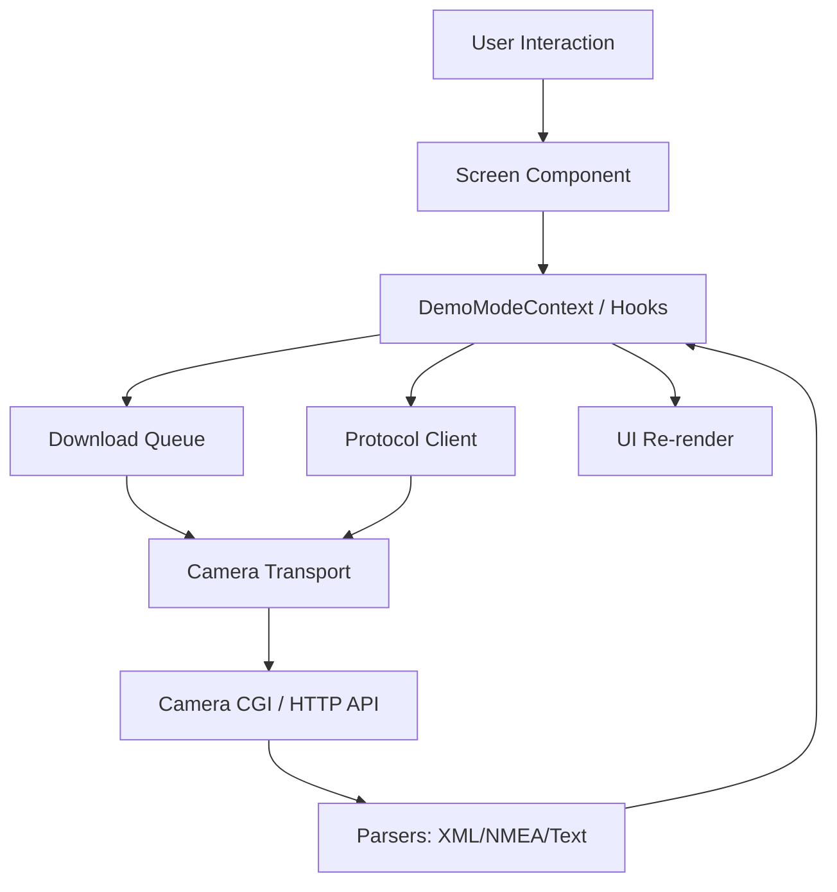
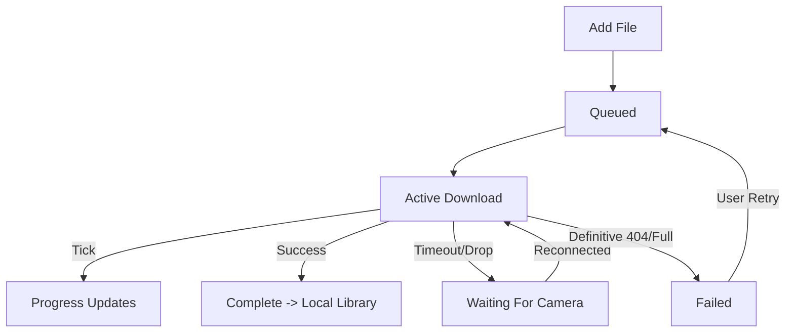

# Laneory

**Professional dashcam companion app for MiVue cameras**

Laneory is an independent mobile application for iOS and Android that connects to your MiVue dashcam over Wi-Fi, giving you complete control over your camera, recordings, and GPS data—all from your phone.

> **Note:** Laneory is an independent application, not affiliated with or endorsed by Mio/MiTAC. It is designed for legally owned MiVue cameras and follows documented interoperability protocols.

---

## Quick Start

### Prerequisites

- iOS 13.0+ or Android 8.0+
- MiVue dashcam with Wi-Fi capability
- Both devices connected to the same Wi-Fi network (or connected to camera's AP)

### Installation

For development using Expo Go:

```bash
cd mobile
npm install
npm start
```
*(Scan the QR code from the terminal using the Expo Go app).*

For a development build with native HTTP streaming (`http10-tcp` module):

```bash
cd mobile
npm install
npm run build:dev:ios  # or android
npm run start:dev-client
```

### First Connection

1. Open Laneory and complete the onboarding.
2. Ensure you are connected to the camera's Wi-Fi network.
3. The app will connect automatically or you can input the IP manually via **Settings → Camera**.
4. Browse your recordings in the **Library** tab.

---

## Features

### Camera Control & Connection

- **Auto-Discovery**: Finds MiVue cameras on your network.
- **Manual IP Configuration**: Direct IP input if the camera uses a custom configuration.
- **Demo Mode**: Explore the full UI using synthetic files and simulated download queues without a physical camera.
- **Connection Status**: Real-time connection indicators (Live, Demo, Reconnecting, Failed).
- **Camera Info**: Read firmware, safety camera data, and voice package version.

### Video Library Management

- **High-Performance Lists**: Powered by `FlashList` for smooth scrolling even with thousands of clips.
- **Smart Filtering**: Filter by `Normal`, `Event`, `Parking`, or `Photo`.
- **Flexible Sorting**: Sort chronologically (Newest/Oldest) or by Name/Size.
- **Multi-Select**: Long-press any clip to enter selection mode for batch downloads or deletion.
- **Download Queue**: 
  - Background downloads with progress tracking and persistent state.
  - Automatic retry on network interruption and recoverable errors.
  - Resume support for partial downloads.
- **Video Playback**: 
  - Player using `expo-video` with scrubbing, playback speed, and Picture-in-Picture.
- **Refresh on Demand**: Pull-to-refresh to sync with the camera library without losing your download queue.

### Local Storage

- **Downloaded Files Manager**: Browse clips saved natively to your device.
- **Offline Playback**: Watch downloaded videos without connecting to the camera.
- **Storage Management**: Grouped storage breakdown (Camera vs Local) and bulk local cleanup.

### GPS & Route Tracking

- **Interactive Map**: Online map powered by `Leaflet` / `OpenStreetMap` tiles (opt-in).
- **Schematic Route**: Fully offline schematic view available when no internet is present.
- **Synchronized Playback**: The location marker scrubs alongside the video playback.
- **Route Statistics**: Distance, average speed, max speed, and duration extracted from NMEA telemetry.

### Camera Settings

Hardware settings you can configure directly from the app (if supported by your camera model):

- **Frequency**: 50Hz / 60Hz.
- **Exposure Compensation (EV)**: Adjust brightness (-1.0 to +1.0).
- **Date & Time Mode**: GPS Sync or Manual.
- **Time Zone**: GMT offsets.
- **Daylight Saving Time**: +1 hour, -1 hour, etc.
- **Format SD Card**: Safely wipe camera storage through a centralized mutation flow with secondary confirmation.

---

## Design System

Laneory uses a semantic design token system stored in `constants/Theme.ts` to seamlessly adapt to Light, Dark, and OLED modes.

### Color Palette

The app uses a distinct Teal/Navy theme to remain completely separate from the manufacturer's brand.

| Token | Light | Dark |
|-------|-------|------|
| **Background** | `#eef2f5` | `#0b1220` |
| **Surface** | `#f8fafc` | `#121a28` |
| **Brand (Teal)** | `#0f766e` | `#14b8a6` |
| **Text** | `#0f1720` | `#e8eef4` |
| **Border** | `#d5dee7` | `#243044` |
| **Live Alert** | `#FF5A36` | `#FF7256` |

File categories use specific accents:
- **Normal**: Teal (`#0f766e` / `#14b8a6`)
- **Event**: Amber (`#f59e0b`)
- **Parking**: Sky Blue (`#0ea5e9`)
- **Photo**: Purple (`#8b5cf6`)

### Typography

Using `SourceSans3` and `IBMPlexMono` (for tabular data/clocks):

- **xs / sm / base / lg / xl / 2xl**: Font sizes scaling from 11px to 30px.
- **caption / body / subtitle / title**: Semantic text styles defined in the Theme.

### Spacing & Shadows

- **Spacing**: `xs`(4), `sm`(8), `md`(12), `lg`(16), `xl`(20), `xxl`(24), `xxxl`(32).
- **Radius**: Soft rounded corners with tokens up to `pill`(999) for tags.

### Animations & Haptics

- **Haptic Feedback**: Provided via `src/utils/haptics.ts` (Selection, Light, Medium, Success, Warning).
- **Animated Toggle**: Custom `ThemeToggle.tsx` providing a smooth sliding knob with opacity crossfades.
- **Press Scale**: Standard `0.95` scale spring animation on cards via `usePressAnimation`.

---

## Architecture

### Project Structure

Structura completă a fișierelor, folderelor și subfolderelor proiectului `mobile/` la zi:

```text
mobile/
├── .claude/
│   └── settings.json                     # Setări specifice asistentului Claude
├── .vscode/
│   ├── extensions.json                   # Extensii VS Code recomandate
│   └── settings.json                     # Setări formatare workspace
├── app/                                  # Expo Router - Navigare UI bazată pe fișiere
│   ├── (tabs)/                           # Layout-ul de tab-uri principale
│   │   ├── _layout.tsx                   # Configurația barei de navigare (TabBar)
│   │   ├── index.tsx                     # 1. Camera Library (Tab principal - lista fișiere remote)
│   │   ├── local.tsx                     # 2. Local Files (Fișiere descărcate)
│   │   ├── settings.tsx                  # 4. Settings Hub (Centrul de setări)
│   │   └── two.tsx                       # 3. Download Queue (Coada descărcărilor)
│   ├── onboarding/                       # Fluxul de Setup Inițial (Wizard)
│   │   ├── _layout.tsx                   # Layout flux onboarding
│   │   ├── add-camera.tsx                # Interfață adăugare manuală cameră
│   │   ├── connect.tsx                   # Procesul de conectare IP/Wi-Fi
│   │   ├── index.tsx                     # Ecran de start onboarding
│   │   ├── select-camera.tsx             # Selectare model cameră
│   │   ├── success.tsx                   # Confirmare setup reușit
│   │   └── terms.tsx                     # Termeni și condiții utilizare
│   ├── settings/                         # Sub-ecrane din interiorul Settings
│   │   ├── _layout.tsx                   # Layout navigare stack setări
│   │   ├── about.tsx                     # Informații versiune, legal și contact
│   │   ├── camera.tsx                    # Configurare IP, diagnoză IP și update status hardware
│   │   ├── dev-logs.tsx                  # Acces vizual la jurnalele Developer
│   │   ├── diagnostics.tsx               # Diagnoză stare rețea și status aplicație
│   │   ├── legal.tsx                     # Centralizator documente legale
│   │   ├── maps-privacy.tsx              # Confidențialitate hărți și comutare opt-in
│   │   └── storage.tsx                   # Vizualizare spațiu stocare, cache și formatare SD
│   ├── +html.tsx                         # Template root HTML pentru exportul web
│   ├── +not-found.tsx                    # Fallback 404 standard (Unmatched Route)
│   ├── _layout.tsx                       # Layout Root al aplicației (Provideri globali)
│   ├── connection-help.tsx               # Ghid de depanare pentru problemele de conexiune
│   ├── legal-document.tsx                # Vizualizator generic pentru documente tip T&C
│   ├── modal.tsx                         # Bază pentru vizualizare tip Modal (prezentare UI)
│   └── player.tsx                        # Video Player Fullscreen + Telemetrie GPS & Hartă
├── assets/                               # Resurse statice brute incluse la build
│   ├── brand/                            # Logo-uri, lockup-uri și identitatea Laneory
│   ├── fonts/                            # Fonturi statice TTF (ex. SpaceMono-Regular)
│   ├── images/                           # Iconițele de aplicație (Android/iOS) și splash screen-ul
│   └── map/                              # Template harta HTML offline (online-map.html)
├── components/                           # Baza de componente React UI (incl. fișiere de test *.test.ts)
│   ├── camera/                           # UI specific conexiunii, badge status și items remote (Cards)
│   ├── diagnostics/                      # Formatoare loguri sistem și sheet-uri de detalii erori
│   ├── environment/                      # Detectare mediu runtime (Expo Go vs Build Nativ)
│   ├── feedback/                         # Componente de feedback vizual neintruziv (ex. ScreenToast)
│   ├── gps/                              # Vizualizare rută GPS (WebView, Schematic, TelemetryStats)
│   ├── library/                          # Bare cu tab-uri, controale de sortare și selecție
│   ├── local/                            # Gestiune stocare internă (ștergere, share, header dată)
│   ├── media/                            # Layout-uri generice media, badge-uri timestamp și categorii
│   ├── navigation/                       # Componente custom de nav (LaneoryTabBar, Headere statice)
│   ├── onboarding/                       # Fragmente de UI refolosite in wizard-ul de conexiune
│   ├── player/                           # Sub-componentele Player-ului video (butoane PIP, scrubbing)
│   ├── queue/                            # Componente pentru Download Queue (thumbnail, stare, progres)
│   ├── selection/                        # Bare de instrumente active pe timpul selecției multiple (Bulk)
│   ├── settings/                         # Layout sub-setări, ecrane slide-up (Sheets) și afișaj valori
│   ├── sheets/                           # Template-uri pentru Bottom Sheets personalizate Laneory
│   ├── startup/                          # View-uri afișate in starea de boostrap (capsule loader)
│   ├── ui/                               # Primitive UI Laneory (Button, Card, Badge, ProgressBar)
│   ├── EditScreenInfo.tsx                # Helper UI utilizat la dezvoltare
│   ├── ExternalLink.tsx                  # Wrapper pentru deschiderea de link-uri web in siguranță
│   ├── QueueThumbnail.tsx                # Previzualizare card pentru elemente in descărcare
│   ├── StyledText.tsx                    # Alias de tipografie mapat la fontul Laneory
│   ├── Themed.tsx                        # Componente primitive (View, Text) auto-adaptabile Dark/Light
│   ├── VideoThumbnail.tsx                # Componentă de previzualizare cadre din fluxurile locale
│   ├── cameraThumb.ts                    # Helper preluare/generare URL-uri miniaturi cameră
│   ├── contrast.ts                       # Helper algoritmic calcul contrast culori text/background
│   ├── mediaMeta.ts                      # Parsare proprietăți metadata clip (rezoluție, durată)
│   ├── useClientOnlyValue.ts             # Hook prevenire diferențe server/client in medii web
│   ├── useColorScheme.ts                 # Hook citire setare temă sistem
│   └── videoThumbCache.ts                # Subsistem de stocare/invalidare caching fișiere
├── constants/                            # Declarația constantelor globale de sistem
│   ├── Brand.ts                          # Numele produsului și atribute brand string
│   ├── CategoryStyle.ts                  # Harta culorilor per categorie (Normal, Event, Parking)
│   ├── Colors.ts                         # Token-urile legacy de culoare (in proces de înlocuire)
│   └── Theme.ts                          # Sistemul Master de Design Tokens (Spacing, Shadows, Colors)
├── context/                              # React Contexts legacy și wrapper stări extinse
│   ├── DemoModeContext.tsx               # Context ce dictează sursa datelor (Cameră vs Fișiere Mock)
│   ├── demoModeRemoteClear.test.ts       # Suită teste validare refresh UI
│   └── SelectionTabChromeContext.tsx     # Context pentru blocarea UI-ului in timpul Select-All
├── generated/                            # Director automatizat în timpul build-ului
│   └── thirdPartyLicenses.*              # JSON/TS cu lista componentelor Open Source (licențe)
├── hooks/                                # Custom Hook-uri reutilizabile react (State, UI behavior)
│   ├── useBackToTop.ts                   # Helper navigare sus in FlatList-uri lungi (inclusiv teste)
│   ├── useLibraryFilters.ts              # Logica state-ului intern de filtre
│   └── useVerticalOverflow.ts            # Evaluare scroll necesar pe conținut
├── modules/                              # Expo Native Modules (Cod specific OS scris în Kotlin/Swift)
│   ├── background-download-spike/        # Execuție Sesiuni Background URLSession (Exclusiv iOS)
│   ├── http10-tcp/                       # Implementare TCP Client Nativ pentru streaming HTTP/1.0
│   └── wifi-ssid/                        # Extragere nume rețea Wi-Fi curentă
├── packages/                             # Pachete interne cu responsabilitate logică fixă
│   ├── camera-transport/                 # Adaptoare rețea HTTP/TCP, stream bypass, validări Path/CGI
│   ├── demo/                             # Mock-uri date, generatoare coordonate false (Demo Mode)
│   ├── download-queue/                   # Sistem enqueueing, retry timeout, resume file offset
│   ├── local-db/                         # Salvare/Încărcare persistentă (AsyncStorage) stări descărcări
│   ├── parsers/                          # Analizoare de XML, Config Text (CGI format) și GPS NMEA
│   └── protocol/                         # Validarea strictă a cererilor mutative (Mutații config cameră)
├── plugins/                              # Config plugins Expo pentru injectări și modificări native Info.plist / Manifest
│   ├── withBackgroundDownloadSpike.js    # Injects background session app capabilities
│   ├── withLocalNetworkCleartext.js      # Allows local IP unencrypted HTTP traffic (bypasses ATS)
│   └── withWifiSsidAccess.js             # Adds precise location/network entitlements for SSID reading
├── scripts/                              # Rutine Node.js de automatizare rulate la pre-build
│   └── generate-third-party-licenses.cjs # Analizează package.json și extrage licențele OSS
├── src/                                  # Arhitectura nouă / refactorizare TypeScript strictă
│   ├── components/                       # Componente specifice refactorizate (ThemeSelector, ConnectionStatus)
│   ├── contexts/                         # Modern ThemeContext implementation
│   ├── hooks/                            # Modern app hooks (useCamera, useTheme, useFiles, usePressAnimation)
│   ├── services/                         # Wrapper logic de servicii (cameraSettings, fileManagement)
│   ├── theme/                            # Definiții tipizate extinse pentru Theme Design System
│   ├── types/                            # Interfețe globale Laneory
│   └── utils/haptics.ts                  # Wrapper centralizat și safe pentru Haptics
├── .env.example                          # Template pentru structura variabilelor de mediu opționale
├── .gitignore                            # Fișiere/directoare ignorate de git
├── AGENTS.md                             # Policy de asistență tehnică AI specific codebase-ului
├── CLAUDE.md                             # Regulamentul de prioritizare fișiere pentru asistentul Claude
├── LICENSE                               # Declarația licenței de utilizare a codului sursă
├── README.md                             # Documentația principală tehnică a proiectului (Acest fișier)
├── app.json                              # Fișier manifest Expo (Metadata OS, SDK ver, bundle ID)
├── eas.json                              # Profiluri EAS pentru cloud build (development, preview, production)
├── metro.config.js                       # Configurație Metro bundler pentru rezolvarea modulelor interne
├── package-lock.json                     # Arborele de dependențe NPM lock
├── package.json                          # Dependențe NPM, configurări pachete interne și scripturi build
└── tsconfig.json                         # Configurația de tratare TypeScript strict a întregului monorepo
```

### Data Flow



### Download Queue Lifecycle



---

## Tech Stack

### Core Framework

- **[Expo SDK 54](https://expo.dev/)**: Latest development platform and build toolchain.
- **[React Native](https://reactnative.dev/)**: Cross-platform mobile framework.
- **[TypeScript](https://www.typescriptlang.org/)**: Type-safe development.
- **[Expo Router v4](https://docs.expo.dev/router/introduction/)**: File-based deep linking and navigation.

### UI & Interaction

- **[@shopify/flash-list](https://shopify.github.io/flash-list/)**: Constant-memory virtualization for large camera libraries.
- **[expo-video](https://docs.expo.dev/versions/latest/sdk/video/)**: Native video playback replacing legacy AV module.
- **[expo-haptics](https://docs.expo.dev/versions/latest/sdk/haptics/)**: System-integrated tactile feedback.

### Network & Data

- **AsyncStorage**: Lightweight persistent key-value store for preferences and queue metadata.
- **Custom Protocol Parsers**: Dependency-free parsing of non-standard MiVue XML lists and NMEA text files.
- **Native Modules**: Includes `http10-tcp` to bypass React Native's `fetch` limitations when talking to embedded hardware that drops modern chunked streams.

### Developer Tools

- **Node `--test` / `tsx`**: Fast, lightweight test runner using Node's built-in module.
- **[EAS Build](https://docs.expo.dev/build/introduction/)**: Cloud compilation for iOS and Android.
- **[EAS Update](https://docs.expo.dev/eas-update/introduction/)**: Over-the-air JavaScript patches without app store resubmission.

---

## Camera Protocol

Laneory communicates with the MiVue series via the CGI HTTP protocol. Operations use pre-execution capability verification and post-execution state auditing.

### Example Supported Mutative Operations

- `Camera.Menu.Flicker` (50Hz / 60Hz)
- `Camera.Menu.EV` (Exposure compensation)
- `Camera.Menu.RtcGps` (GPS time sync vs Manual)
- `Camera.Menu.RtcTimezone` 
- `Camera.Menu.RtcDaylight`
- `action=format` (SD Card cleanup)

All configuration parsing is housed in `packages/parsers/src/parser.ts`, while strict mutation logic resides in `packages/protocol/src/cameraSettings.ts`.

---

## Development

### Running the Test Suite

The project uses native Node testing via `tsx`:

```bash
cd mobile
npm test
# Or for type verification:
npm run typecheck
```

*Note: The test suite currently executes over 600 assertions targeting parsers, queue lifecycle, URL generation, telemetry logic, and settings formatting.*

### Builds & Deployments

Laneory uses **EAS Build** for production compilation and **EAS Update** for OTA code patches.

```bash
# Push an OTA update to the preview branch:
npm run update:preview -- "Fixed spacing on camera settings"

# Build a development client for physical devices:
npm run build:dev:ios
```

---

## Legal & Compliance

Laneory is an **independent, third-party application** developed for interoperability with legally owned dashcams.

- **Not affiliated with** Mio Technology Corporation or MiTAC.
- "Mio" and "MiVue" are trademarks used factually for compatibility identification only.
- Designed strictly for **non-commercial personal use**.
- Implements features by verifying compatibility with hardware you own; it does not bypass security, extract proprietary firmware, or impersonate official endpoints.

---

**Built with ❤️ for dashcam owners who value local, independent, and performant control.**
