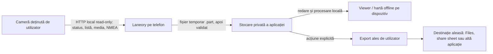
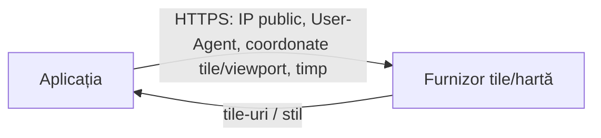

> **MATERIAL PREGĂTITOR — NU CONSTITUIE CONSULTANȚĂ JURIDICĂ. Necesită revizuire de avocat RO/UE specializat în software și proprietate intelectuală înainte de orice folosire comercială.**

# Hartă privacy și fluxuri de date

**Versiune:** 0.1  
**Data:** 19 iulie 2026  
**Ipoteză de bază:** local-first, fără cloud/analytics/ads implicit

## 1. Principii

- aplicația interacționează numai cu o cameră deținută/controlată de utilizator;
- toate acțiunile de conectare, listare, download și export sunt pornite de utilizator;
- datele camerei rămân pe cameră sau pe telefon, cu excepția unui export explicit;
- aplicația nu stochează parola Wi‑Fi și nu o include în loguri;
- nu există cont, backend, telemetrie, advertising ID sau upload implicit;
- datele și căile primite de la cameră sunt intrări neîncrezătoare;
- setările implicite minimizează stocarea, backup-ul și vizibilitatea către alte aplicații.

Acestea sunt cerințe de produs, nu constatări despre un build mobil încă inexistent.

## 2. Fluxul local propus

În profilul de bază nu există săgeată către infrastructura dezvoltatorului ori un furnizor de hartă.

## 3. Inventarul datelor

| Date | Sursă | Scop | Locație implicită | Retenție propusă | Riscuri |
|---|---|---|---|---|---|
| video/foto | cardul camerei | vizualizare și download | cameră; apoi storage privat dacă utilizatorul descarcă | până la ștergerea explicită/local OS | fețe, plăcuțe, domiciliu, incidente, minori |
| audio din clip | camera | redare | ca parte din media | ca media | conversații și voce |
| NMEA/GPS/traseu, timp, viteză | sidecar cameră | hartă/GPX | memorie și storage privat/GPX exportat | până la ștergere/export | locație precisă, rutină, domiciliu, profil de deplasare |
| accelerometru | sidecar cameră | afișare opțională `[TBD]` | local | minim necesar | inferențe despre incidente/comportament |
| nume/cale fișier, dimensiune, timestamps | listare cameră | catalog și validare | cache local | sesiune sau cache limitat | program/rutină; input malițios |
| SSID cameră | OS/rețea | ghidare conexiune `[TBD]` | preferabil numai în memorie | sesiune | identificator al dispozitivului/locului |
| IP cameră și port | rețea locală | discovery/conectare | memorie; preferință locală opțională | până la resetarea setărilor | topologie rețea, spoofing |
| model, firmware, header server | cameră | compatibilitate/diagnostic | local | până la reset sau log redactat | fingerprint dispozitiv |
| progres download și erori | aplicație | UX/suport local | memorie; log local minim | rotație scurtă | căi, nume, IP sau metadate accidentale |
| preferințe aplicație | utilizator | funcționare | storage privat | până la reset/dezinstalare | preferințe și istoric |
| fișiere Demo Mode | incluse în aplicație | review/onboarding | bundle/local | durata instalării | trebuie să fie sintetice ori cu drepturi complete |

## 4. Controale cerute

### Acces și transport

- prompt contextual pentru rețeaua locală și explicație clară a scopului;
- endpoint allowlist/validare: adresă locală, port așteptat, răspuns de status cu structură validă;
- fără fallback către hosturi internet și fără cleartext în afara rețelei locale;
- timeouts, limite de corp/header și protecție împotriva răspunsurilor supradimensionate;
- o singură coadă de transfer până la confirmarea concurenței serverului.

### Stocare

- storage privat al aplicației; fișierele nu devin publice decât la export explicit;
- nume locale generate/sanitizate, fără utilizarea directă a căii remote;
- creare exclusivă `.part`, validare dimensiune, finalizare atomică unde este posibil și fără suprascriere;
- cleanup controlat al fișierelor parțiale, cu alegerea utilizatorului când recuperarea este utilă;
- excludere din backup cloud implicit pentru media sensibilă, dacă produsul și platforma permit; decizia trebuie documentată;
- ștergere locală ușor accesibilă și opțiune de ștergere a cache-ului/istoricului.

### Loguri și suport

- fără coordonate, SSID complet, IP, nume/căi media, thumbnails sau conținut în logurile standard;
- diagnostic exportabil doar după preview și consimțământ explicit, cu redacție automată;
- fără crash SDK până la aprobarea separată a furnizorului, transferurilor și retenției;
- fără upload automat de diagnostic.

### Export și partajare

- system picker/share sheet; utilizatorul vede destinația;
- avertisment că exportul mută datele sub politica altei aplicații/furnizor;
- nu se elimină sau alterează originalul de pe cameră;
- păstrarea metadatelor GPS în video/foto/GPX este explicată înainte de export, cu opțiune de eliminare dacă produsul o implementează.

## 5. Hartă online — schimbare materială

Dacă se adaugă o hartă online, fluxul devine:

Înainte de activare sunt obligatorii:

1. alegerea și contractarea unui furnizor care permite volumul și cazul de utilizare;
2. data processing/transfer assessment și identificarea operatorilor/împuterniciților;
3. actualizarea privacy policy, App Privacy și Data Safety;
4. informare înainte de primul request și un mecanism valid de alegere/consimțământ dacă avocatul stabilește această bază;
5. hartă offline sau vedere fără tile-uri ca alternativă rezonabilă;
6. minimizarea preciziei/zonei și interdicția de a trimite traseul complet dacă tile-urile necesare pot fi cerute local;
7. retenție și logare contractuale minime, regiuni de procesare și reguli pentru transfer internațional;
8. attribution și termeni pentru date/tile-uri.

Consimțământul UI nu repară singur o bază legală, un transfer ori termeni incompatibili; avocatul/privacy lead stabilește mecanismul corect.

## 6. Distincția GDPR versus etichete store

Procesarea exclusiv pe dispozitiv poate rămâne „prelucrare de date personale” în sens larg, chiar dacă dezvoltatorul nu primește datele. Separat, Apple definește „collect” pentru eticheta App Privacy în jurul transmiterii off-device accesibile dezvoltatorului/partenerilor peste timpul necesar requestului, iar Google cere declararea practicilor aplicației și SDK-urilor. De aceea:

- nu se deduce automat „Data Not Collected” din termenul local-first;
- build-ul final și toate SDK-urile sunt testate la nivel de trafic;
- rolurile GDPR și eventuala excepție pentru activități exclusiv personale/domestice sunt analizate pe utilizarea reală și jurisdicție;
- funcțiile enterprise, fleet, sharing sau cloud declanșează o analiză nouă.

Referințe store: [Apple App Privacy Details](https://developer.apple.com/app-store/app-privacy-details/) și [Google Play Data Safety](https://support.google.com/googleplay/android-developer/answer/10787469?hl=en).

## 7. Întrebări deschise

- Cine este operatorul pentru funcțiile și site-ul aplicației?
- Se păstrează vreun diagnostic după ce utilizatorul contactează suportul?
- Media este exclusă din iCloud/Android backup și cum se comunică acest lucru?
- Care este retenția implicită pentru cache, thumbnails și catalog?
- Se oferă redarea directă fără download și ce cache produce playerul?
- Se elimină GPS/metadate la share sau doar la alegerea utilizatorului?
- Ce se întâmplă la dezinstalare, migrare dispozitiv și restore?
- Va exista hartă online, crash reporting, analytics, cont sau cloud în vreo variantă?

## 8. Gate

Fluxul de bază local-first este o cerință încă neimplementată. Privacy lead-ul și avocatul trebuie să aprobe inventarul, retenția, backup-ul, exportul, textele de permisiuni și declarațiile magazinelor pe baza build-ului final.
