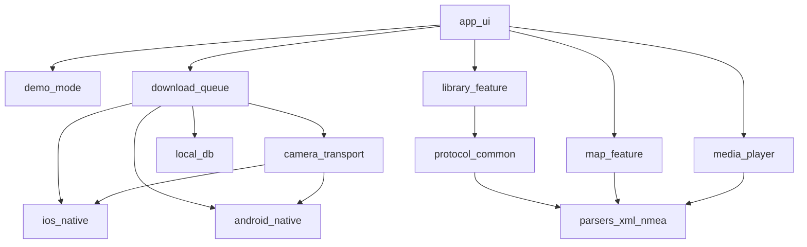

# Arhitectura aplicației mobile

**Statut:** Faza 3 — UI pe Expo Go (filtre, Local, player); native Http10Tcp amânat (Apple Developer)  
**Framework:** React Native + Expo prebuild / development builds ([adr-001-framework.md](adr-001-framework.md))  
**Locație:** subfolder `mobile/` în acest monorepo  
**Produs:** `Laneory`  
**Notă:** Expo Go = Demo + Fetch probe. TCP HTTP/1.0 nativ = modul `modules/http10-tcp` + EAS development build (vezi `mobile/README.md`, Faza 2b).

## 1. Principii

- Local-first: fără cont, cloud, analytics sau upload implicit.
- Cameră: numai GET/HEAD; fără `set`/`del`/firmware.
- Un singur transfer activ către cameră; coadă persistentă și vizibilă.
- Selectarea unui card **nu** pornește download.
- UI original — nu clonează MiVue Pro.
- Specificație de protocol: doar observații BBX aprobate + standarde publice; fără materiale APK din carantină.
- Identitate proprie: User-Agent, GPX creator/namespace, fără „MiVue” în metadate generate.

## 2. Structură monorepo (țintă Faza 2)

```text
mobile/
  app/                    # Expo Router (UI minimal Faza 2)
  packages/
    protocol/             # tipuri, client read-only, erori
    parsers/              # Config.cgi text, XML list, NMEA/GPX
    camera-transport/     # contract Transport + Demo/Fetch stub + native later
    download-queue/       # coadă persistentă, un worker
    local-db/             # stare coadă, preferințe
    demo/                 # fixtures sintetice
  plugins/                # config plugins ATS/cleartext (ulterior)
  ios/ android/           # generate via expo prebuild (development builds)
```

CLI-ul existent din rădăcină rămâne separat. Nu se importă `cameraMutate` / `probe`.

## 3. Module și dependențe



| Modul | Responsabilitate | Nu face |
|---|---|---|
| `protocol_common` | endpoint, status, list paginat, headFile, tipuri RemoteFile | mutate, probe APK |
| `parsers_xml_nmea` | parseConfig, parseFileListXml, NMEA checksum, GPX | UI, rețea |
| `camera_transport` | request HTTP/1.0, timeout, max body, host allowlist | Range resume fals |
| `download_queue` | enqueue, un activ, progres, `.part` → validate → rename | paralelism cameră |
| `local_db` | fișiere locale, poziție coadă, cache list TTL | cloud sync |
| `library_feature` | filtre, sort, lazy thumbs (pool ≤2), day separators | auto-download la tap |
| `media_player` | MP4 local, scrub + GPS sync | încărcare întreg fișier în RAM |
| `map_feature` | traseu local; tile online doar după consimțământ | OSM public ca infra garantată |
| `demo_mode` | aceleași ecrane pe date sintetice | mimează „cameră găsită” |
| `ios_native` / `android_native` | TCP, storage privat, FGS/notificări, cleartext local | MANAGE_EXTERNAL_STORAGE |

## 4. Fluxuri cheie

### Conectare

1. Onboarding: explică Wi‑Fi cameră; IP manual sau discovery candidați (implicit `192.72.1.1` nu e asumat permanent).
2. Validare status read-only înainte de listare.
3. Permisiuni rețea locală contextual (iOS / Android).
4. Fără stocare parolă Wi‑Fi.

### Bibliotecă

1. Listare pe categorii cu paginare; sort recent-first.
2. Thumbnails lazy, pool serializat/limitat.
3. Etichete `Descarcă` / `Descărcat`; tap pe card → detalii, nu download.

### Download

1. Acțiune explicită → item în coadă.
2. Worker unic: HEAD → GET → `.part` → validare dimensiune → rename atomic unde e posibil.
3. Progres: bytes, total, viteză, etapă, poziție coadă.
4. Navigarea UI nu anulează transferul; pierderea Wi‑Fi → eșec controlat, fără resume fals.

## 5. Ecrane minime

1. Onboarding / conectare  
2. Biblioteca camerei  
3. Coada de descărcări  
4. Fișiere locale  
5. Player + GPS  
6. Setări confidențialitate  
7. Compatibilitate / firmware ([../compatibility.md](../compatibility.md))  
8. About / licențe / disclaimer  
9. Demo Mode  

## 6. Securitate (rezumat)

Detalii: [threat-model.md](threat-model.md). Minim: allowlist host local, validare `/SD/` fără `..`, limite corp/header, fără log GPS/SSID/căi în producție, SSRF blocked (fără fetch internet pentru cameră).

## 7. Ce se portează din CLI vs rescriere

| Sursă CLI | Acțiune |
|---|---|
| `parser.ts`, `nmea.ts` (fără brand în GPX) | portare TS în `packages/parsers` |
| pattern download `.part` | rescriere pe storage nativ |
| `pathSafety` (fără delete helpers) | rescriere politici read-only |
| discovery | specificație + adapter nativ |
| `cameraMutate.ts`, `probe.ts`, UI `web/` | **excluse** |

## 8. Gate către Faza 2

- ADR-001 acceptat de titular.
- Specificația de protocol pentru implementatori fără secțiuni carantină.
- Nume/bundle ID încă pot fi placeholder, dar structura modulelor e stabilă.
