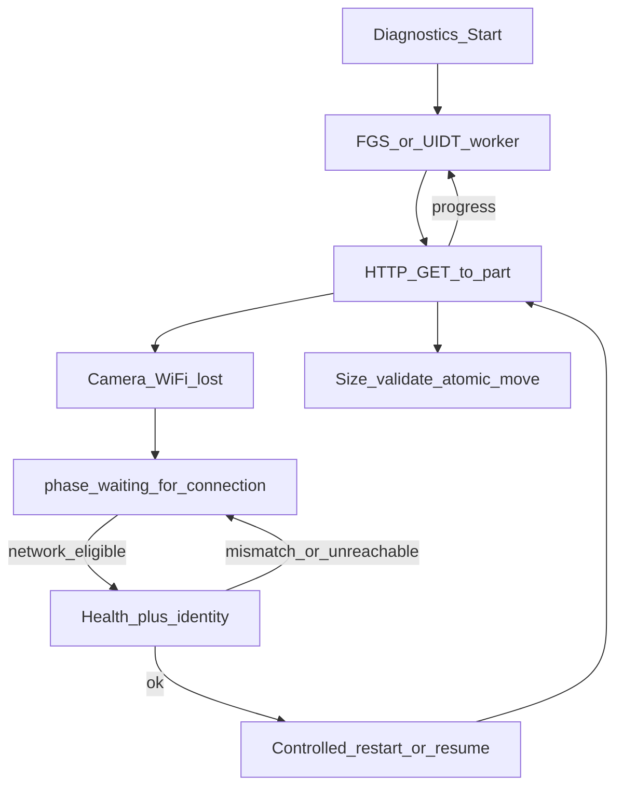

# Stage 0B — Android background download feasibility (proposal)

**Status:** **deferred — not implementing now.** Proposal kept for later; no Android spike code until explicitly requested.  
**Relation to iOS Stage 0:** independent. Android results must **not** be treated as proof that `URLSession.background` works on MiVue 866.  
**iOS gate:** `BLOCKED — physical-device signing unavailable` (see [background-download-spike.md](./background-download-spike.md)).

## Goal

On a legally owned MiVue 866 + Android phone (buildable from Windows via EAS/`expo run:android`), measure whether a **user-initiated** long download can:

- continue while the app is backgrounded (FGS / long-running worker — not JS `setInterval`);
- show a mandatory notification with progress + Cancel;
- enter `waiting_for_connection` when camera Wi‑Fi is lost (not definitive Failed);
- auto-resume only after **camera** reachability + identity check (not merely `NetworkType.CONNECTED` / any Wi‑Fi / mobile data);
- persist progress and rehydrate after process death;
- finish with size validation and no duplicate bytes (full GET; no assumed Range/206).

Out of scope for 0B:

- DownloadQueue / DemoModeContext production wiring;
- shared production `BackgroundDownloadCoordinator` (Etapa 1);
- claiming iOS readiness;
- changing signing / Play release credentials beyond what’s needed for a debug/dev build.

## Proposed approach (concrete)

| Concern | Choice for spike |
|---|---|
| Transfer ownership | Native Android only while spike is active (single task) |
| Long-running API | Prefer **User-Initiated Data Transfer (UIDT)** Job where API level allows; else **Foreground Service** (`dataSync` / appropriate type) with persistent notification |
| HTTP to camera | Prefer reuse of existing **HTTP/1.0 TCP** patterns from `http10-tcp` inside the worker (camera is known HTTP/1.0-sensitive). Document if OkHttp/HttpURLConnection alone fails |
| Waiting | On socket/network failure → phase `waiting_for_connection`; stop next GETs; keep partial file metadata |
| Resume after Wi‑Fi return | Worker/Connectivity callback → **read-only health** (e.g. status CGI) + **identity** (model/firmware or existing software-identity keys) vs values captured at Start; only then restart GET from byte 0 if Range unconfirmed, or document Range if observed |
| Mobile data / wrong SSID | Stay waiting; do not hammer private camera IP |
| Cancel | Notification action + JS Cancel → stop worker, delete or keep `.part` per explicit spike policy (default: delete on user cancel) |
| Expo Go | `isAvailable() === false`; requires development/dev-client build |

## Files to add (when implementing)

| Path | Role |
|---|---|
| `mobile/modules/background-download-spike-android/` (or `…/android/` under a shared spike package) | Expo module: Kotlin FGS/UIDT, notification, persist, events |
| `…/android/src/main/java/.../BackgroundDownloadSpikeService.kt` | Foreground service / job entry |
| `…/android/src/main/java/.../BackgroundDownloadSpikeWorker.kt` | Transfer loop + waiting/rehydrate |
| `…/android/src/main/java/.../SpikeCameraHealth.kt` | Read-only health + identity check (private IPv4 only) |
| `…/android/src/main/AndroidManifest.xml` (via config plugin) | FGS type, `FOREGROUND_SERVICE*`, `POST_NOTIFICATIONS`, service/receiver declarations |
| `mobile/plugins/withBackgroundDownloadSpikeAndroid.js` | Manifest permissions + service; **no** release signing changes |
| `mobile/modules/.../index.ts` | `isAvailable`, `start`, `cancel`, `getActiveTask`, `restore`, `addListener` |
| `mobile/components/settings/BackgroundDownloadSpikeAndroidPanel.tsx` | Diagnostics UI, **off by default**, separate from iOS panel |
| `docs/mobile/background-download-spike-android-0b.md` | This proposal → becomes runbook + gate tables after impl |
| Wire: `mobile/package.json`, `mobile/app.json` | dependency + plugin |

Optional: extend existing `background-download-spike` with an `android/` tree instead of a second package — still **iOS code untouched**; Android stub today remains “not implemented” until 0B lands.

## Diagnostics UI (proposed)

- Separate toggle: `laneory.bgDownloadSpikeAndroid.enabled` (default off).
- Fields: host (session), remote `/SD/…`, expected bytes, optional expected model/firmware snapshot for identity.
- Actions: Start / Cancel / Refresh / Restore.
- Log: phase, bytes, http status, health result, identity match/mismatch — redacted (no secrets).

## Device checklist (fill after impl)

| # | Step | Result |
|---|---|---|
| 1 | Start in foreground; notification appears | TBD |
| 2 | App backgrounded; transfer continues under FGS/UIDT | TBD |
| 3 | Leave camera Wi‑Fi | TBD |
| 4 | Phase `waiting_for_connection`; not Failed | TBD |
| 5 | Rejoin camera Wi‑Fi | TBD |
| 6 | Health + identity pass → auto resume/restart | TBD |
| 7 | Process kill → rehydrate + continue or controlled restart | TBD |
| 8 | Cancel from notification stops transfer | TBD |
| 9 | On mobile data only → stays waiting | TBD |
| 10 | Same IP, wrong identity → no download | TBD |
| 11 | Final size OK; no duplicate bytes | TBD |

## Gate (Android 0B only)

| Verdict | Next |
|---|---|
| **pass** | May later inform Android Etapa 3 design; still **no** iOS Etapa 1/2 |
| **partial** | Document OEM/FGS limits; keep foreground queue behavior |
| **fail** | Do not build fake Android background abstraction |
| Android pass ≠ iOS pass | Always |

## Explicit non-goals until approved

- No code in this proposal cycle.
- No DownloadQueue production integration.
- No removal of iOS Stage 0 spike.
- No EAS credentials / signing profile changes beyond normal Android debug/dev builds the user already uses.
