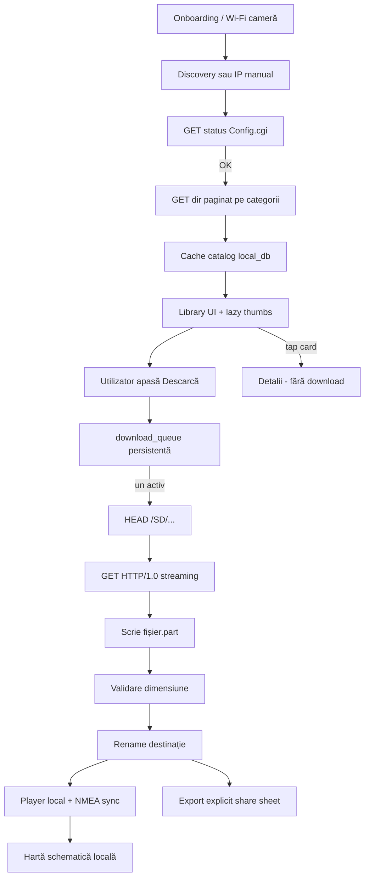
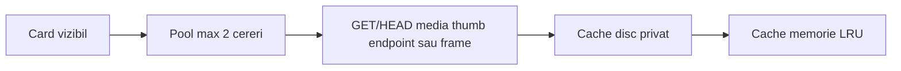
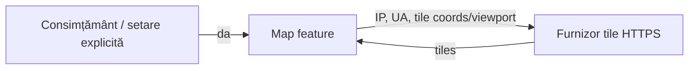

# Data-flow tehnic — aplicație mobilă

**Statut:** Faza 1  
**Privacy legal:** [../legal/privacy-data-flow.md](../legal/privacy-data-flow.md)  
**Produs:** `[NUMELE_APLICAȚIEI]`

## 1. Flux principal (local-first)

Reguli:

- Nicio săgeată către serverele dezvoltatorului în profilul de bază.
- Selectarea cardului ≠ enqueue.
- Un singur `get` media activ către cameră.

## 2. Etape download (detaliu)

| Etapă | Date în memorie | Date pe disc | Ieșire la eșec |
|---|---|---|---|
| queued | id, path remote hash/sanitized, size așteptat | rând coadă în DB | rămâne queued |
| head | Content-Length | — | failed; retry controlat |
| transferring | buffer stream mic | `.part` | păstrează/curăță `.part` per politică; fără resume fals |
| validating | size counters | `.part` | nu rename |
| completed | — | fișier final | — |
| cancelled | — | `.part` opțional | utilizatorul decide cleanup |

## 3. Thumbnails

Serializare/limită obligatorie; eșec thumb ≠ eșec listă.

## 4. GPS / NMEA

1. Sidecar `.NMEA` descărcat sau citit local.
2. Parser validează checksum; produce eșantioane în memorie pentru scrub.
3. Export GPX la cerere, cu creator/namespace proprii (fără „MiVue”).
4. Coordonatele nu apar în loguri producție.

## 5. Ramură opțională — hartă online

Înainte de primul request: actualizare privacy, App Privacy, Data Safety; atribuire OSM + furnizor; alternativă offline. Nu se folosește `tile.openstreetmap.org` ca infrastructură garantată de produs.

## 6. Demo Mode

Înlocuiește `camera_transport` cu `demo` repository: aceleași tipuri `RemoteFile`, progres simulat, media sintetică. Nu emite trafic către IP-uri de cameră. Vezi [demo-mode.md](demo-mode.md).

## 7. Date care nu circulă

- Parola Wi‑Fi
- Cont utilizator / advertising ID
- Upload cloud automat
- Analytics / crash SDK (implicit dezactivate)
- Comenzi `set` / `del`
