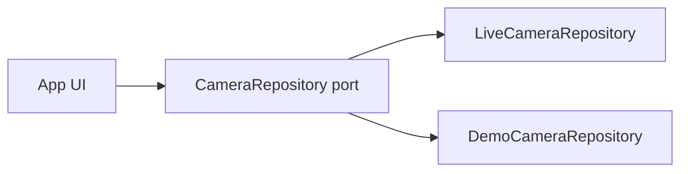

# Plan Demo Mode

**Statut:** Faza 1  
**Scop:** App Review Apple / Google Play fără cameră fizică  
**Produs:** `Laneory`

## 1. Cerințe

- Accesibil fără cont, fără Wi‑Fi special, fără credențiale.
- Aceleași ecrane principale ca produsul real (bibliotecă, coadă, local, player, GPS schematic, about).
- Etichetă persistentă vizibilă: **Demo Mode**.
- Nu afișează „cameră găsită” pentru un host real; datele sunt etichetate ca demonstrație.
- Zero trafic către IP-uri tip cameră (`192.72.1.1` etc.) în Demo Mode.
- Active sintetice: fără fețe reale, fără GPS real de trasee private, fără materiale Mio/MiTAC.

## 2. Arhitectură



Comutator: setare în About / deep link documentat în Review Notes / flag build review dacă e necesar. Implicit off în producție pentru utilizatori; ușor de activat pentru reviewer.

## 3. Fixtures

| Asset | Specificație |
|---|---|
| Catalog | 12–20 intrări pe categorii Normal/Parking/Event/Photo, timestamps pe ≥2 zile |
| Dimensiuni | realiste (MB), pentru progres download |
| Miniaturi | imagini generate (gradient/pattern), nu frame-uri din cameră reală |
| Video | clip scurt H.264 + audio suportat nativ (AAC) generat intern |
| NMEA/GPS | traseu sintetic (ex. poligon urban fictiv), fără coordonate din înregistrări reale |
| Status | răspuns config sintetic `0` / `OK` |

Licență: active create de titular sau cu licență comercială clară; inventariate în third-party-licenses.

## 4. Comportament simulat

| Acțiune reală | Demo |
|---|---|
| Discovery | mesaj „Demo Mode — date sintetice”; nu scanează LAN |
| List / filtre / sort | pe fixtures |
| Thumbnails | din cache demo |
| Enqueue download | coadă reală a app-ului, sursă = asset local / copy simulat cu progres |
| Progres | bytes/viteză/etapă vizibile; un singur „transfer” activ |
| Player + hartă schematică | pe clipul și traseul sintetic |
| Hartă online | tot opt-in; poate rămâne dezactivată în demo |
| Mutate | absent |

## 5. Review Notes (schelet)

```text
Laneory is an independent app, not affiliated with Mio/MiTAC.

Hardware: optional Mio MiVue 866 on the camera's Wi-Fi. The app uses
local HTTP to list/download files and, when confirmed for the model,
user-initiated camera settings and file operations on a user-owned device.

Demo Mode (no camera required):
1. Open the app → About (or Settings) → Enable Demo Mode
2. Browse the library, queue a download, open the player and schematic map
3. Persistent "Demo Mode" banner confirms synthetic data

Local Network: used only when connecting to a real camera on the LAN.
The app does not change camera settings, delete camera files, or update firmware.
```

## 6. Testare acceptanță Demo Mode

- [ ] Pornire fără rețea / mod avion
- [ ] Nicio conexiune outbound către hosturi cameră (verificare proxy/trafic)
- [ ] VoiceOver / TalkBack pe fluxul principal
- [ ] Dynamic Type / contrast pe eticheta Demo Mode
- [ ] Orientare și ecran mic
- [ ] Coadă persistă la kill app (stare demo)
- [ ] Ieșirea din Demo Mode șterge sau izolează cache-ul demo (fără amestec cu media reală)

## 7. Gate

Demo Mode este criteriu de acceptare pentru Faza 3 UI și obligatoriu înainte de orice submit (Faza 4).
