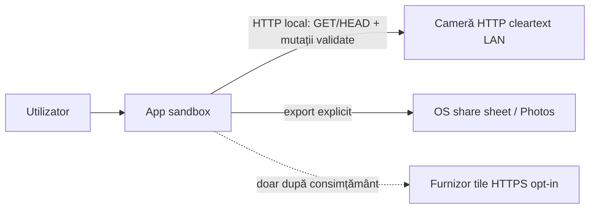

# Threat model STRIDE — `Laneory`

**Statut:** Faza 1 — draft tehnic  
**Data:** 20 iulie 2026  
**Domeniu:** aplicație mobilă local-first; HTTP local către cameră (read și mutații validate)  
**Complement:** [../legal/privacy-data-flow.md](../legal/privacy-data-flow.md)

## 1. Active

| Activ | Sensibilitate |
|---|---|
| Video / foto descărcate | ridicată (fețe, plăcuțe, incidente) |
| NMEA / GPS / trasee / timp | ridicată |
| Catalog căi/nume/timestamps | medie |
| SSID / IP cameră / firmware | medie (fingerprint) |
| Coadă download / `.part` | medie (integritate + spațiu) |
| Preferințe locale | scăzută–medie |
| Demo fixtures | scăzută (trebuie sintetice) |

## 2. Actori de amenințare

- Cameră sau host local malițios pe același Wi‑Fi (spoof gateway).
- Rețea locală ostilă (MITM cleartext HTTP).
- Aplicații pe dispozitiv care citesc storage partajat greșit configurat.
- Utilizator / support care exportează diagnostic cu date sensibile.
- Erori de implementare (path traversal, SSRF, race pe coadă).

## 3. Matrice STRIDE

### Spoofing

| Amenințare | Mitigare |
|---|---|
| Host care se dă drept cameră | validare răspuns status (`code`/`OK`/`status`); allowlist IP privat; fără redirect către internet |
| UI care mimează „oficial Mio” | brand propriu + disclaimer; fără asset-uri MiTAC |

### Tampering

| Amenințare | Mitigare |
|---|---|
| XML/listă coruptă sau path `/SD/../…` | parser strict; `assertRemotePath`; nume locale generate, nu calea remote brută |
| Truncare download | `.part` + comparare `Content-Length` / expected; fără rename dacă mismatch |
| Două transferuri care corup același fișier | un singur worker; lock pe destinație; fără overwrite fără confirmare |

### Repudiation

| Amenințare | Mitigare |
|---|---|
| „Nu am pornit downloadul” | acțiune explicită + stare coadă persistentă cu timestamp local (fără PII în loguri cloud — nu există cloud) |

### Information disclosure

| Amenințare | Mitigare |
|---|---|
| Loguri cu GPS/SSID/căi | redacție în producție; diagnostic doar cu preview + consimțământ |
| Backup cloud al media | excludere backup unde platforma permite; documentat în privacy |
| Hartă online care trimite viewport | opt-in; fără traseu complet ca query; vezi data-flow |
| Cleartext pe LAN | acceptat doar local; ATS/cleartext limitat; avertizare UX |

### Denial of service

| Amenințare | Mitigare |
|---|---|
| Răspunsuri uriașe la list/status | `maxBodyBytes`, timeout, anulare |
| Umplere disc | check spațiu înainte; cleanup `.part`; eroare clară |
| Spam thumbnails | pool ≤2; serializare; cache local |
| Cameră care blochează la concurență | un transfer activ; fără paralelism CGI greu |

### Elevation of privilege

| Amenințare | Mitigare |
|---|---|
| Escape din sandbox storage | scoped storage / container app; fără `MANAGE_EXTERNAL_STORAGE` |
| SSRF via path/host controlat de listă | host fix din sesiune validată; path doar `/SD/…` relativ la același host |
| Mutate accidental | absența totală a `set`/`del` din binary mobil |

## 4. Trust boundaries

Camera este **neîncrezătoare**. Furnizorul de tile este **neîncrezător** și opțional. Nu există backend propriu în profilul de bază.

## 5. Non-obiective de securitate (MVP)

- Autentificare pe cameră (dispozitivul testat nu cere HTTP auth pe fluxurile confirmate).
- Criptarea end-to-end a LAN-ului camerei (imposibil fără schimbare firmware).
- Protecție împotriva unui atacator cu root pe telefonul utilizatorului.

## 6. Gate

Threat model-ul se reînnoiește la fiecare SDK nou, hartă online, crash reporting sau orice host extern. Review de securitate înainte de Faza 4.
