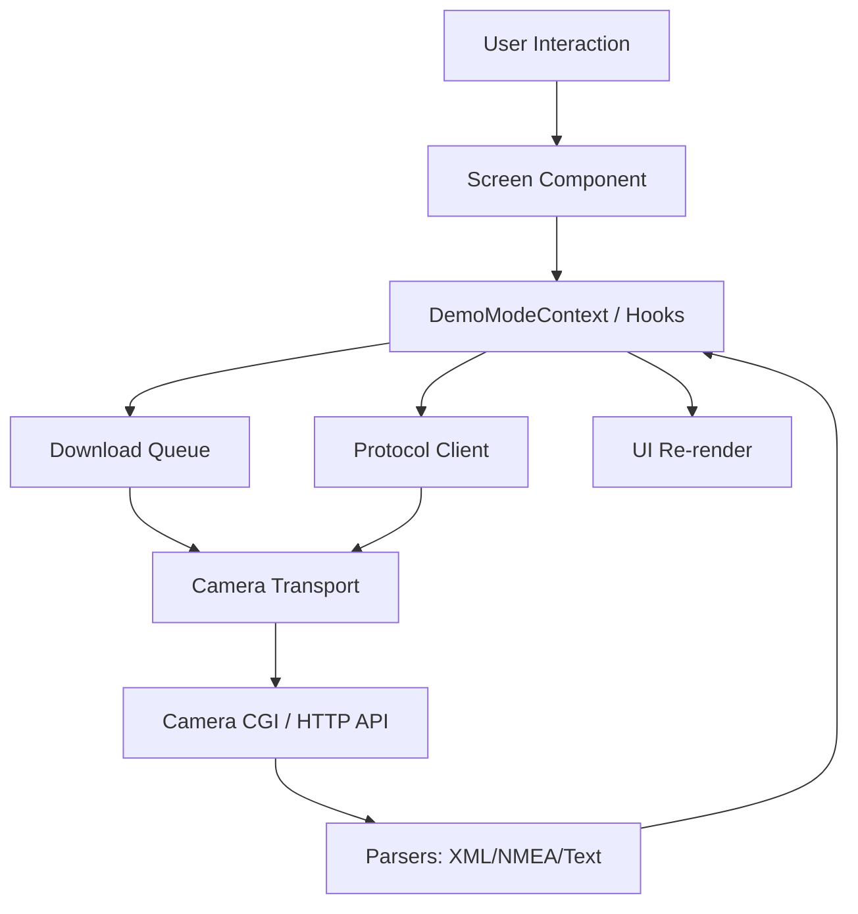
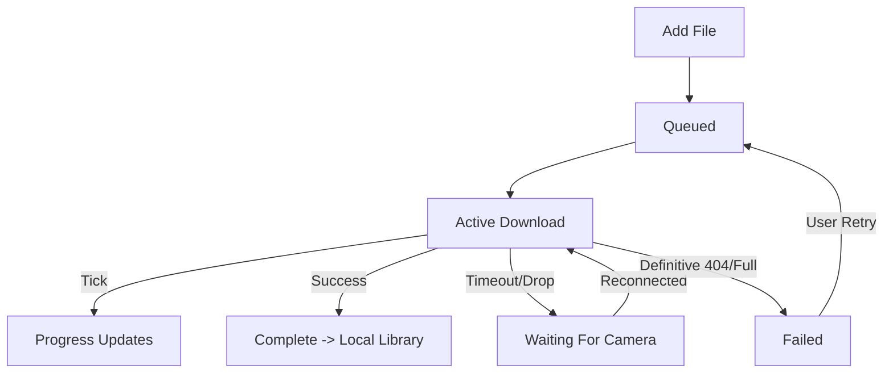

# Laneory

**Professional dashcam companion app for MiVue cameras**

Laneory is an independent mobile application for iOS and Android that connects to your MiVue dashcam over Wi-Fi, giving you complete control over your camera, recordings, and GPS data—all from your phone.

> **Note:** Laneory is an independent application, not affiliated with or endorsed by Mio/MiTAC. It is designed for legally owned MiVue cameras and follows documented interoperability protocols.

---

## Quick Start

### Prerequisites

- iOS 13.0+ or Android 8.0+
- MiVue dashcam with Wi-Fi capability
- Both devices connected to the same Wi-Fi network (or connected to camera's AP)

### Installation

For development using Expo Go:

```bash
cd mobile
npm install
npm start
```
*(Scan the QR code from the terminal using the Expo Go app).*

For a development build with native HTTP streaming (`http10-tcp` module):

```bash
cd mobile
npm install
npm run build:dev:ios  # or android
npm run start:dev-client
```

### First Connection

1. Open Laneory and complete the onboarding.
2. Ensure you are connected to the camera's Wi-Fi network.
3. The app will connect automatically or you can input the IP manually via **Settings → Camera**.
4. Browse your recordings in the **Library** tab.

---

## Features

### Camera Control & Connection

- **Auto-Discovery**: Finds MiVue cameras on your network.
- **Manual IP Configuration**: Direct IP input if the camera uses a custom configuration.
- **Demo Mode**: Explore the full UI using synthetic files and simulated download queues without a physical camera.
- **Connection Status**: Real-time connection indicators (Live, Demo, Reconnecting, Failed).
- **Camera Info**: Read firmware, safety camera data, and voice package version.

### Video Library Management

- **High-Performance Lists**: Powered by `FlashList` for smooth scrolling even with thousands of clips.
- **Smart Filtering**: Filter by `Normal`, `Event`, `Parking`, or `Photo`.
- **Flexible Sorting**: Sort chronologically (Newest/Oldest) or by Name/Size.
- **Multi-Select**: Long-press any clip to enter selection mode for batch downloads or deletion.
- **Download Queue**: 
  - Background downloads with progress tracking and persistent state.
  - Automatic retry on network interruption and recoverable errors.
  - Resume support for partial downloads.
- **Video Playback**: 
  - Player using `expo-video` with scrubbing, playback speed, and Picture-in-Picture.
- **Refresh on Demand**: Pull-to-refresh to sync with the camera library without losing your download queue.

### Local Storage

- **Downloaded Files Manager**: Browse clips saved natively to your device.
- **Offline Playback**: Watch downloaded videos without connecting to the camera.
- **Storage Management**: Grouped storage breakdown (Camera vs Local) and bulk local cleanup.

### GPS & Route Tracking

- **Interactive Map**: Online map powered by `Leaflet` / `OpenStreetMap` tiles (opt-in).
- **Schematic Route**: Fully offline schematic view available when no internet is present.
- **Synchronized Playback**: The location marker scrubs alongside the video playback.
- **Route Statistics**: Distance, average speed, max speed, and duration extracted from NMEA telemetry.

### Camera Settings

Hardware settings you can configure directly from the app (if supported by your camera model):

- **Frequency**: 50Hz / 60Hz.
- **Exposure Compensation (EV)**: Adjust brightness (-1.0 to +1.0).
- **Date & Time Mode**: GPS Sync or Manual.
- **Time Zone**: GMT offsets.
- **Daylight Saving Time**: +1 hour, -1 hour, etc.
- **Format SD Card**: Safely wipe camera storage through a centralized mutation flow with secondary confirmation.

---

## Design System

Laneory uses a semantic design token system stored in `constants/Theme.ts` to seamlessly adapt to Light, Dark, and OLED modes.

### Color Palette

The app uses a distinct Teal/Navy theme to remain completely separate from the manufacturer's brand.

| Token | Light | Dark |
|-------|-------|------|
| **Background** | `#eef2f5` | `#0b1220` |
| **Surface** | `#f8fafc` | `#121a28` |
| **Brand (Teal)** | `#0f766e` | `#14b8a6` |
| **Text** | `#0f1720` | `#e8eef4` |
| **Border** | `#d5dee7` | `#243044` |
| **Live Alert** | `#FF5A36` | `#FF7256` |

File categories use specific accents:
- **Normal**: Teal (`#0f766e` / `#14b8a6`)
- **Event**: Amber (`#f59e0b`)
- **Parking**: Sky Blue (`#0ea5e9`)
- **Photo**: Purple (`#8b5cf6`)

### Typography

Using `SourceSans3` and `IBMPlexMono` (for tabular data/clocks):

- **xs / sm / base / lg / xl / 2xl**: Font sizes scaling from 11px to 30px.
- **caption / body / subtitle / title**: Semantic text styles defined in the Theme.

### Spacing & Shadows

- **Spacing**: `xs`(4), `sm`(8), `md`(12), `lg`(16), `xl`(20), `xxl`(24), `xxxl`(32).
- **Radius**: Soft rounded corners with tokens up to `pill`(999) for tags.

### Animations & Haptics

- **Haptic Feedback**: Provided via `src/utils/haptics.ts` (Selection, Light, Medium, Success, Warning).
- **Animated Toggle**: Custom `ThemeToggle.tsx` providing a smooth sliding knob with opacity crossfades.
- **Press Scale**: Standard `0.95` scale spring animation on cards via `usePressAnimation`.

---

## Architecture

### Project Structure

```text
mobile/
├── app/                        # Expo Router file-based UI navigation
│   ├── (tabs)/                 # Main bottom tabs
│   │   ├── index.tsx           # 1. Camera Library
│   │   ├── local.tsx           # 2. Local Files
│   │   ├── two.tsx             # 3. Download Queue
│   │   └── settings.tsx        # 4. Settings Hub
│   ├── settings/               # Nested setting screens
│   │   ├── camera.tsx          # IP & Hardware Settings
│   │   ├── storage.tsx         # Storage Breakdown & Format SD
│   │   ├── maps-privacy.tsx    # Online/Offline map toggle
│   │   ├── dev-logs.tsx        # Diagnostic internal logs
│   │   └── about.tsx           # Legal & version info
│   ├── onboarding/             # Initial setup flow
│   ├── player.tsx              # Fullscreen Video & GPS Player
│   └── _layout.tsx             # Root layout and theme injection
│
├── components/                 # Reusable UI features
│   ├── camera/                 # Remote file items, filtering, sync logic
│   ├── local/                  # Local file management
│   ├── queue/                  # Download queue presentation
│   ├── player/                 # Media player controls
│   ├── gps/                    # Telemetry panels and maps
│   └── settings/               # Settings rows, sheets, and logic
│
├── constants/                  
│   └── Theme.ts                # Token system & specific values
│
├── contexts/                   
│   ├── DemoModeContext.tsx     # Provides camera state (Live/Demo), link health
│   ├── ThemeContext.tsx        # Provides user-selected theme and applier
│   └── SelectionTabChromeContext.tsx # Contextual headers during multi-select
│
├── hooks/                      # Custom logic (e.g. useBackToTop, useVerticalOverflow)
│
├── packages/                   # Internal abstracted packages
│   ├── protocol/               # Client for MiVue CGI parsing and mutations
│   ├── parsers/                # XML (file lists), Text (settings), NMEA (GPS)
│   ├── download-queue/         # Resilient download worker and state
│   ├── camera-transport/       # Base network fetching & native streaming stub
│   ├── local-db/               # SQLite/AsyncStorage queue state persistence
│   └── demo/                   # Fixtures and synthetic file servers
│
├── modules/                    # Native Expo modules
│   ├── background-download-spike/ # Background URLSession module (iOS focus)
│   ├── http10-tcp/             # Native TCP socket for streaming
│   └── wifi-ssid/              # Reading connected network name
│
├── eas.json                    # EAS configuration (dev, preview, prod profiles)
└── package.json
```

### Data Flow



### Download Queue Lifecycle



---

## Tech Stack

### Core Framework

- **[Expo SDK 54](https://expo.dev/)**: Latest development platform and build toolchain.
- **[React Native](https://reactnative.dev/)**: Cross-platform mobile framework.
- **[TypeScript](https://www.typescriptlang.org/)**: Type-safe development.
- **[Expo Router v4](https://docs.expo.dev/router/introduction/)**: File-based deep linking and navigation.

### UI & Interaction

- **[@shopify/flash-list](https://shopify.github.io/flash-list/)**: Constant-memory virtualization for large camera libraries.
- **[expo-video](https://docs.expo.dev/versions/latest/sdk/video/)**: Native video playback replacing legacy AV module.
- **[expo-haptics](https://docs.expo.dev/versions/latest/sdk/haptics/)**: System-integrated tactile feedback.

### Network & Data

- **AsyncStorage**: Lightweight persistent key-value store for preferences and queue metadata.
- **Custom Protocol Parsers**: Dependency-free parsing of non-standard MiVue XML lists and NMEA text files.
- **Native Modules**: Includes `http10-tcp` to bypass React Native's `fetch` limitations when talking to embedded hardware that drops modern chunked streams.

### Developer Tools

- **Node `--test` / `tsx`**: Fast, lightweight test runner using Node's built-in module.
- **[EAS Build](https://docs.expo.dev/build/introduction/)**: Cloud compilation for iOS and Android.
- **[EAS Update](https://docs.expo.dev/eas-update/introduction/)**: Over-the-air JavaScript patches without app store resubmission.

---

## Camera Protocol

Laneory communicates with the MiVue series via the CGI HTTP protocol. Operations use pre-execution capability verification and post-execution state auditing.

### Example Supported Mutative Operations

- `Camera.Menu.Flicker` (50Hz / 60Hz)
- `Camera.Menu.EV` (Exposure compensation)
- `Camera.Menu.RtcGps` (GPS time sync vs Manual)
- `Camera.Menu.RtcTimezone` 
- `Camera.Menu.RtcDaylight`
- `action=format` (SD Card cleanup)

All configuration parsing is housed in `packages/parsers/src/parser.ts`, while strict mutation logic resides in `packages/protocol/src/cameraSettings.ts`.

---

## Development

### Running the Test Suite

The project uses native Node testing via `tsx`:

```bash
cd mobile
npm test
# Or for type verification:
npm run typecheck
```

*Note: The test suite currently executes over 600 assertions targeting parsers, queue lifecycle, URL generation, telemetry logic, and settings formatting.*

### Builds & Deployments

Laneory uses **EAS Build** for production compilation and **EAS Update** for OTA code patches.

```bash
# Push an OTA update to the preview branch:
npm run update:preview -- "Fixed spacing on camera settings"

# Build a development client for physical devices:
npm run build:dev:ios
```

---

## Legal & Compliance

Laneory is an **independent, third-party application** developed for interoperability with legally owned dashcams.

- **Not affiliated with** Mio Technology Corporation or MiTAC.
- "Mio" and "MiVue" are trademarks used factually for compatibility identification only.
- Designed strictly for **non-commercial personal use**.
- Implements features by verifying compatibility with hardware you own; it does not bypass security, extract proprietary firmware, or impersonate official endpoints.

---

**Built with ❤️ for dashcam owners who value local, independent, and performant control.**
